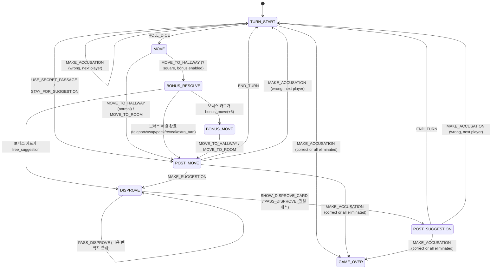

# 04. Turn Flow (State Machine)

## 페이즈 상태 다이어그램

## 페이즈별 요약
- **`TURN_START`**: 현재 플레이어가 주사위 굴리기(`ROLL_DICE`), 비밀 통로 이용(`USE_SECRET_PASSAGE`), 소환된 방에서 바로 추리 준비(`STAY_FOR_SUGGESTION`), 또는 즉시 최종 추리(`MAKE_ACCUSATION`) 중 선택.
- **`MOVE`**: 주사위 합(`movement_remaining`) 이내로 복도 칸 또는 방으로 이동. `?` 칸에 멈추면 즉시 보너스 카드를 뽑아 `BONUS_RESOLVE`로 진입.
- **`BONUS_RESOLVE`**: 뽑은 물음표 보너스 카드의 효과를 해결하는 하위 상태 머신.
- **`BONUS_MOVE`**: `bonus_move`(+6) 카드로 부여된 추가 이동 페이즈. (연쇄 `?` 드로우 금지)
- **`POST_MOVE`**: 이동 완료 후 상태. 방 안에 있으면 추리(`MAKE_SUGGESTION`) 가능, 언제든 `MAKE_ACCUSATION` 또는 `END_TURN` 가능.
- **`DISPROVE`**: 추리된 3장 중 1장을 시계 방향 순서로 반박 대기.
- **`POST_SUGGESTION`**: 추리 및 반박 종료 후. `MAKE_ACCUSATION` 또는 `END_TURN`만 가능 (한 턴에 일반 추리는 1회).
- **`GAME_OVER`**: 게임 종료. 모든 액션 거부(`GAME_ALREADY_OVER`).
