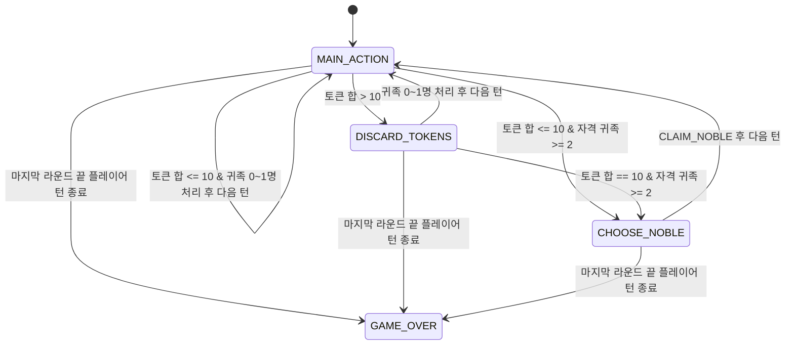

# 04. Turn Flow (State Machine)

## 턴 종료 파이프라인 (모든 메인 액션 또는 버리기 완료 후 공통 실행)
1. **토큰 한도 검사**: 보유 토큰 총합 > 10이면 `phase = "DISCARD_TOKENS"`로 전이하고 종료 대기.
2. **귀족 방문 검사**: 현재 플레이어의 `bonuses`가 요구 조건 이상인 `nobles` 목록(`eligible`) 계산.
   - `len(eligible) >= 2`: `pending_nobles = eligible`, `phase = "CHOOSE_NOBLE"`로 전이.
   - `len(eligible) == 1`: 해당 귀족을 자동 영입(`NOBLE_VISITED` 이벤트 발행, `+3`점).
   - `len(eligible) == 0`: 귀족 방문 없음.
3. **최종 라운드 트리거 검사**: 현재 플레이어 `points >= config.target_points`이고 `final_round == False`이면 `final_round = True`, `FINAL_ROUND_TRIGGERED` 이벤트 발행.
4. **턴 전환 / 게임 종료**:
   - `TURN_ENDED` 이벤트 발행.
   - `final_round == True`이고 `current_player_index == len(turn_order) - 1`이면 `outcome` 계산 후 `phase = "GAME_OVER"`, `GAME_ENDED` 발행.
   - 그렇지 않으면 다음 플레이어로 이동, `turn_number += 1`, `phase = "MAIN_ACTION"`, `TURN_STARTED` 발행.
